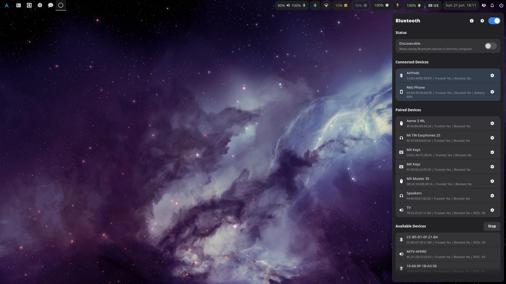

# Bluetooth Manager Sidebar



Native GTK4/libadwaita Bluetooth sidebar for Wayland desktops. Opens as a right-side panel from the CLI, app launchers, hotkeys, or Waybar.

## Features

- View adapter power, discoverable state, pairing-agent status, and file-receiving status.
- Scan for Bluetooth devices and connect, disconnect, pair, trust, block, or remove devices.
- Send files to connected Bluetooth devices and authorize incoming file transfers.
- View device details including identity, connection state, battery, security, and audio profile information.
- Change Bluetooth audio profiles through `pactl` when available.

## Installation

On Arch Linux, install [`bm-sidebar`](https://aur.archlinux.org/packages/bm-sidebar) from the AUR.

Prebuilt packages are also available in [GitHub Releases](https://github.com/Relz/bluetooth-manager-sidebar/releases): Debian/Ubuntu (`.deb`), Fedora/RHEL-family (`.rpm`), Arch Linux (`.pkg.tar.zst`), or Alpine Linux (`.apk`).

Requires a Wayland compositor with layer-shell support and these dependencies:

- GTK 4.12+, libadwaita 1.4+, and `gtk4-layer-shell`.
- GLib/GIO 2.76+, including GIO Unix support, and JSON-GLib.
- BlueZ on the system bus.
- BlueZ OBEX service on the session bus for file transfer.
- `pactl` for audio profile actions.
- `rfkill` for Bluetooth unblock recovery.

The `pactl` package is `pulseaudio-utils` on Debian/Ubuntu, Fedora/RHEL-family systems, and Alpine, or `libpulse` on Arch Linux. Arch Linux provides `rfkill` through `util-linux`.

## Usage

```sh
bm-sidebar                # Toggle the sidebar (same as --toggle)
bm-sidebar --show         # Show the sidebar
bm-sidebar --hide         # Hide the sidebar
bm-sidebar --quit         # Quit the running instance
bm-sidebar --reload-css   # Reload user CSS
bm-sidebar --background   # Verify an instance or start hidden
bm-sidebar --help         # Show available options
```

Choose one command per invocation. `--toggle`, `--show`, and `--background` start the app if needed. Other control commands require a running instance. Add `bm-sidebar --background` to your session startup to preload the app.

`--background` starts Bluetooth, pairing-agent, and OBEX receive integration so pairing prompts and incoming file-transfer authorization are available before the sidebar is shown.

### Waybar and monitors

Add an `on-click` entry to your Waybar module:

```json
{
  "on-click": "bm-sidebar --toggle"
}
```

Waybar's `WAYBAR_OUTPUT_NAME` selects the output automatically. Override it with `BM_SIDEBAR_OUTPUT=eDP-1 bm-sidebar --toggle`.

After changing the Waybar config, reload Waybar with:

```sh
pkill -SIGUSR2 -x waybar
```

### Custom styles

Put CSS overrides in `$XDG_CONFIG_HOME/bm-sidebar/bm-sidebar.css` (default: `~/.config/bm-sidebar/bm-sidebar.css`), then run `bm-sidebar --reload-css` to apply them to the running instance.

Base styles come from the checkout's `bm-sidebar.css` or the packaged `/usr/share/bm-sidebar/bm-sidebar.css`.

### Settings

Settings are stored at `$XDG_CONFIG_HOME/bm-sidebar/settings.json` (default: `~/.config/bm-sidebar/settings.json`). If this file is absent, the app reads the legacy `$XDG_CONFIG_HOME/bluetooth-sidebar/settings.json` (default: `~/.config/bluetooth-sidebar/settings.json`). New saves always use the `bm-sidebar` path.

## Bluetooth and file transfer

Scanning stops automatically after 20 seconds. The app registers a default BlueZ pairing agent and handles PIN, passkey, and confirmation prompts.

- **Send files:** Open a device's details and choose **Send file**. The receiving device must support Bluetooth object push.
- **Receive files:** Incoming transfers require approval by default. In settings, **Auto accept files from trusted devices** enables automatic acceptance only for devices marked trusted in BlueZ. **Received files location** defaults to `~/Downloads`.
- **Audio profiles:** Profile controls use `pactl` and depend on the profiles exposed by your audio server.

## Development

### Build and checks

Install Meson, Ninja, pkg-config, a C compiler, and development headers for the dependencies above. Configure once:

```sh
meson setup build
```

Then build, check the CLI, and run from the repository checkout:

```sh
meson compile -C build
./bm-sidebar --help
./bm-sidebar
```

There is currently no test-suite configuration. After edits, use the build and CLI checks above. When a Wayland graphical session is available, smoke-test the sidebar:

```sh
(./bm-sidebar --show & pid=$!; sleep 2; ./bm-sidebar --quit; wait "$pid")
```

The CLI communicates with the GUI helper over `$XDG_RUNTIME_DIR/bm-sidebar.sock`, falling back to `/tmp/bm-sidebar-$UID/bm-sidebar.sock` when `XDG_RUNTIME_DIR` is unset. Runtime directories must be private, owned by the current user, and not symlinks. `--help` does not initialize GTK or Bluetooth/audio services.

### Project layout

- `bm-sidebar`: checkout launcher for the Meson-built native CLI.
- `src/cli/`: command-line parsing, IPC probing, and GUI helper startup.
- `src/command/`: command socket protocol and startup command routing.
- `src/core/`: runtime, configuration, asset paths, and output targeting.
- `src/app/`: Adw application composition, GUI helper entrypoint, and page rendering.
- `src/sidebar/`: layer-shell window and sidebar chrome.
- `src/bluez/`: BlueZ state, adapter, device, discovery, and pairing integration.
- `src/pairing/`: pairing prompt presentation and responses.
- `src/obex/`: OBEX file transfer integration.
- `src/audio/`: audio profile integration through `pactl`.
- `src/settings/`: persisted settings storage.
- `bm-sidebar.css`: application styles.

### Packaging

Native packages install the CLI as `/usr/bin/bm-sidebar`, the GUI helper as `/usr/libexec/bm-sidebar/bm-sidebar-gui`, and application data under `/usr/share/bm-sidebar/`.

The [build-packages workflow](.github/workflows/build-packages.yml) runs on `v*.*.*` tags, syncs the Meson project version from the tag, builds packages with Meson and nFPM, and attaches them to GitHub Releases. When the `AUR_SSH_PRIVATE_KEY` GitHub secret is configured, it also renders [packaging/aur/PKGBUILD.in](packaging/aur/PKGBUILD.in), computes the source checksum and `.SRCINFO`, and publishes AUR metadata for `bm-sidebar`.

Build a native package locally with nFPM:

```sh
rm -rf build-package package-root dist
meson setup build-package --prefix=/usr --libdir=lib --buildtype=release
meson compile -C build-package
DESTDIR="$PWD/package-root" meson install -C build-package
mkdir -p dist
PACKAGE_VERSION=0.0.0 PACKAGE_RELEASE=1 PACKAGE_ARCH=amd64 PACKAGE_HOMEPAGE=https://github.com/Relz/bluetooth-manager-sidebar nfpm package --config packaging/nfpm.yaml --packager deb --target dist/
```

## License

GNU General Public License v3.0 or later. See [LICENSE](LICENSE).
